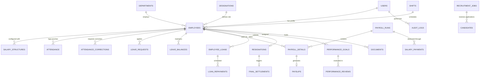

# Database Schema & Relational Specifications
## Arshith Connect HRMS & Automated Payroll Management System

---

## 1. Relational Entity Overview
The system schema is normalized across 22 core domain entities:

---

## 2. Table Specifications

### 1. `users`
- `id` (PK, String/UUID)
- `email` (Unique, String)
- `password_hash` (String)
- `role` (String: `super_admin`, `admin`, `hr`, `payroll`, `manager`, `employee`)
- `is_active` (Boolean)
- `created_at`, `updated_at` (Timestamp)

### 2. `employees`
- `id` (PK, String/UUID)
- `user_id` (FK -> `users.id`, Nullable)
- `employee_id` (Unique, String: `EMP-1001`)
- `full_name` (String)
- `email` (Unique, String)
- `phone` (String)
- `gender` (String)
- `department` (String / FK -> `departments.name`)
- `designation` (String / FK -> `designations.title`)
- `joining_date` (Date)
- `employment_type` (`Full-time`, `Contract`, `Probation`, `Intern`)
- `status` (`Active`, `On Leave`, `Suspended`, `Resigned`, `Terminated`)
- `reporting_manager_id` (FK -> `employees.id`, Nullable)
- `work_location` (String)
- `shift_id` (String / FK -> `shifts.id`)
- `bank_name`, `account_number`, `ifsc_code` (String, Restricted)
- `pan_number`, `uan_number` (String, Restricted)
- `profile_photo_url` (String)

### 3. `salary_structures`
- `id` (PK, String/UUID)
- `employee_id` (FK -> `employees.id`)
- `basic_salary` (Decimal)
- `hra` (Decimal)
- `other_allowances` (Decimal)
- `special_allowance` (Decimal)
- `gross_salary` (Decimal)
- `pf_applicable` (Boolean)
- `pf_wage_base` (Decimal)
- `esi_applicable` (Boolean)
- `professional_tax` (Decimal)
- `tds_monthly` (Decimal)
- `employer_pf` (Decimal)
- `employer_esi` (Decimal)
- `ctc` (Decimal)
- `effective_date` (Date)
- `is_active` (Boolean)

### 4. `payroll_runs`
- `id` (PK, String/UUID)
- `month` (Integer, 1-12)
- `year` (Integer)
- `title` (String, e.g., "October 2026 Payroll")
- `payroll_days` (Integer, e.g., 30)
- `total_gross` (Decimal)
- `total_loss_of_pay` (Decimal)
- `total_deductions` (Decimal)
- `total_net_disbursed` (Decimal)
- `total_employer_cost` (Decimal)
- `status` (Enum: `DRAFT`, `CALCULATED`, `UNDER_REVIEW`, `APPROVED`, `FINALIZED`, `PAYMENT_PROCESSING`, `PAID`, `PARTIALLY_PAID`)
- `approved_by` (FK -> `users.id`)
- `approved_at` (Timestamp)
- `finalized_by` (FK -> `users.id`)
- `finalized_at` (Timestamp)
- `notes` (Text)

### 5. `payroll_details`
- `id` (PK, String/UUID)
- `payroll_run_id` (FK -> `payroll_runs.id`)
- `employee_id` (FK -> `employees.id`)
- `employee_name` (String)
- `department` (String)
- `designation` (String)
- `total_days` (Integer)
- `payable_days` (Decimal)
- `unpaid_days` (Decimal)
- `basic_salary` (Decimal)
- `hra` (Decimal)
- `other_allowances` (Decimal)
- `overtime_pay` (Decimal)
- `bonus` (Decimal)
- `gross_earnings` (Decimal)
- `loss_of_pay` (Decimal)
- `adjusted_gross` (Decimal)
- `employee_pf` (Decimal)
- `employee_esi` (Decimal)
- `professional_tax` (Decimal)
- `income_tax_tds` (Decimal)
- `loan_deduction` (Decimal)
- `total_deductions` (Decimal)
- `net_salary` (Decimal)
- `employer_pf` (Decimal)
- `employer_esi` (Decimal)
- `employer_cost` (Decimal)

### 6. `payslips`
- `id` (PK, String/UUID)
- `payslip_number` (Unique, String: `PS-2026-10-EMP1001`)
- `payroll_run_id` (FK -> `payroll_runs.id`)
- `payroll_detail_id` (FK -> `payroll_details.id`)
- `employee_id` (FK -> `employees.id`)
- `month` (Integer), `year` (Integer)
- `pdf_file_path` (String)
- `generated_at` (Timestamp)
- `status` (`Generated`, `Sent`, `Downloaded`)

### 7. `salary_payments`
- `id` (PK, String/UUID)
- `payroll_run_id` (FK -> `payroll_runs.id`)
- `employee_id` (FK -> `employees.id`)
- `payment_reference` (String)
- `payment_method` (`Bank Transfer`, `NEFT`, `RTGS`, `IMPS`, `Cheque`)
- `amount` (Decimal)
- `status` (`Pending`, `Approved`, `Processing`, `Paid`, `Partially Paid`, `Failed`)
- `transaction_reference` (String, UTR number)
- `payment_date` (Date)
- `processed_by` (FK -> `users.id`)

### 8. `employee_loans`
- `id` (PK, String/UUID)
- `employee_id` (FK -> `employees.id`)
- `loan_type` (`Personal Loan`, `Salary Advance`, `Emergency Fund`)
- `principal_amount` (Decimal)
- `term_months` (Integer)
- `monthly_installment` (Decimal)
- `remaining_balance` (Decimal)
- `status` (`Pending`, `Approved`, `Active`, `Closed`, `Rejected`)
- `disbursed_date` (Date)
- `approved_by` (FK -> `users.id`)

### 9. `resignations` & `final_settlements`
- Resignation request details, notice period days, last working date.
- FnF components: Unpaid days salary, leave encashment amount, gratuity, notice pay recovery, loan recovery, net settlement amount, clearance signoffs.

### 10. `recruitment_jobs` & `candidates`
- Job openings, department, requirements, candidate profile, resume URL, stage (`Applied` -> `Screening` -> `Interview` -> `Offered` -> `Hired`).

### 11. `performance_goals` & `performance_reviews`
- Goals, target dates, review period, self assessment, manager rating (1-5), comments, promotion recommendation.

### 12. `audit_logs`
- `id` (PK), `user_id`, `user_email`, `action`, `entity_type`, `entity_id`, `old_values`, `new_values`, `ip_address`, `timestamp`.
